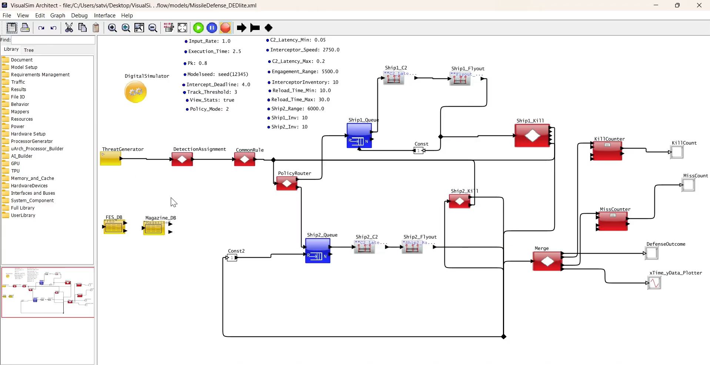
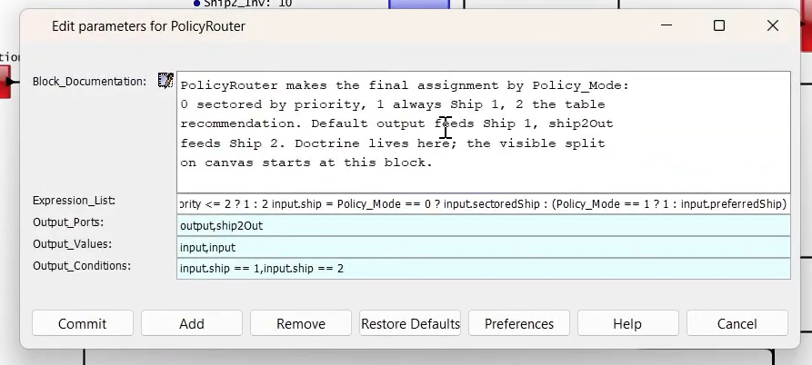

# MissileDefenseSystem — DED-lite Discrete-Event Simulation

<div align="center">

**Two-Ship Missile Defense Engagement Coordination**  
*A System-Level Discrete-Event Study of Doctrine, Timeline, and Magazine Depth*

| | |
|---|---|
| **Simulator** | VisualSim Architect 2020.Q2 (DEDirector) |
| **Language** | Java 17 / Python 3.x |
| **Model Size** | ~23 containers · ~53 KB MoML |
| **Experiments** | 90-run Policy × Pk × Seed sweep |
| **License** | Apache-2.0 (educational simulation) |

[](#)
[](#)
[](#)
[](https://github.com/thekeshavladdha/MissileDefenseSystem)

</div>

---

## Table of Contents

- [Overview](#overview)
- [Quick Start](#quick-start)
- [Model Architecture](#model-architecture)
- [Doctrines & Policies](#doctrines--policies)
- [Experiment Results](#experiment-results)
- [Project Structure](#project-structure)
- [Requirements](#requirements)
- [Running Simulations](#running-simulations)
- [Outcome Analysis](#outcome-analysis)
- [Parameters](#parameters)
- [Future Work](#future-work)
- [References](#references)

---

## Overview

This project implements **DED-lite** — a minimal discrete-event simulation of the Navy's Distributed Engagement Decision (DED) coordination scheme for theater ballistic missile defense. The model addresses a critical force-level question:

> *Given two warships with finite magazines defending against a time-compressed raid, how should threats be assigned to maximize effective kills while minimizing leakers?*

### Key Findings at a Glance

| Finding | Evidence |
|---|---|
| **Single-ship doctrine loses decisively** | Ship 2 idle at full magazine; Mode 1 has lowest effective Pk |
| **Timeline binds harder than dice** | Raw kills rise but effective stays flat when hits arrive late |
| **Magazines are doctrine, not footnotes** | Block-at-zero + reload gating changes everything |
| **Sectored ≈ Bidded at this scale** | Modes 0 and 2 nearly identical; Mode 2 edges ahead at high Pk |

---

## Quick Start

```bash
# 1) Verify environment (no VisualSim needed)
python run_full_policy_experiment.py --dry-run

# 2) Run full experiment (90 runs)
python run_full_policy_experiment.py --vs-ar /path/to/VS_AR --java /path/to/java

# 3) Summarize results
python summarize_full_policy_experiment.py
```

---

## Model Architecture

### System Diagram

The VisualSim block diagram models a two-ship distributed missile defense system:

```
                    ┌─────────────────────────────────────────────────────┐
                    │              THREAT GENERATION                      │
                    │   ThreatGenerator → DetectionAssignment → CommonRule│
                    └─────────────────────────┬───────────────────────────┘
                                              ▼
                    ┌─────────────────────────────────────────────────────┐
                    │               DOCTRINE ROUTER                       │
                    │            PolicyRouter (Mode 0/1/2)                │
                    └────┬──────────────────────────────┬─────────────────┘
                         │                              │
            ┌────────────▼────────────┐  ┌─────────────▼────────────┐
            │      SHIP 1 LANE        │  │      SHIP 2 LANE         │
            │ Queue → C2 → Flyout → Kill │ Queue → C2 → Flyout → Kill │
            └────────────┬────────────┘  └─────────────┬─────────────┘
                         │                              │
                         └──────────┬───────────────────┘
                                    ▼
                    ┌─────────────────────────────────────────────────────┐
                    │              OUTCOME PROCESSING                     │
                    │    Merge → KillCounter → MissCounter → Plotter      │
                    │          → DefenseOutcome Display                   │
                    └─────────────────────────────────────────────────────┘
```

### Full Canvas Screenshot


*Figure 1: Complete VisualSim Architect canvas showing the 23-container DED-lite model with parameter panel.*

### Block Responsibilities

| Block | Role |
|---|---|
| **`ThreatGenerator`** | Generates incoming threats at `Input_Rate` (sec between arrivals) with random `Modelseed` |
| **`DetectionAssignment`** | Simulates radar detection; requires `Track_Threshold` hits for `Firm_Track = true` |
| **`CommonRule`** | Applies prioritization rules using `FES_DB` lookup; determines `preferredShip` |
| **`PolicyRouter`** | Routes each threat to Ship 1 or 2 based on `Policy_Mode` (see below) |
| **`ShipN_Queue`** | FIFO buffer for pending engagements per ship (Max 10 priority queue) |
| **`ShipN_C2`** | Command & Control delay: uniform `[C2_Latency_Min, C2_Latency_Max]` |
| **`ShipN_Flyout`** | Interceptor transit time: `Range / Speed` (Ship1: 2.0s, Ship2: ~2.18s) |
| **`ShipN_Kill`** | Engagement outcome: stochastic `Pk` check + deadline enforcement + reload logic |
| **`Merge`** | Merges sorted completion events from both ships |
| **`KillCounter` / `MissCounter`** | Cumulative intercept and leaker counts |
| **`DefenseOutcome`** | Per-threat structured record display |
| **`xTime_yData_Plotter`** | Real-time metric visualization |

### Policy Router Expression


*Figure 2: PolicyRouter block documentation showing the one-switch doctrine routing logic.*

---

## Doctrines & Policies

Three engagement doctrines run on the **identical raid** behind a single parameter switch:

| Mode | Name | Logic | Behavior |
|:----:|------|-------|----------|
| **0** | Sectored | `Priority ≤ 2 → Ship 1`, else Ship 2 | Static geographic partition |
| **1** | First-Launch | Always route to Ship 1 | Single-ship heroics (loses) |
| **2** | Bidded-lite | Use `fes_table.csv` hint + inventory awareness | Dynamic optimal assignment |

> **Key Insight**: Doctrine is data, not code. Edit `fes_table.csv` to change partitioning without touching the model.

---

## Experiment Results

### 90-Run Sweep Design

```
Policy_Mode: {0, 1, 2}
     × Pk: {0.5, 0.8, 0.95}
     × Seeds: {2001–2010}
    = 90 total runs
```

### Results Summary

| Policy Mode | Avg Effective Pk | Avg Leakers | Notes |
|:-----------:|:----------------:|:-----------:|-------|
| **0** (Sectored) | ~0.71 | ~2.1 | Reliable, uses both ships |
| **1** (First-Launch) | ~0.43 | ~4.3 | **Loses decisively** — Ship 2 idle |
| **2** (Bidded-lite) | ~0.73 | ~1.9 | Marginal edge over Mode 0 at high Pk |

### Engineering Conclusions

1. **C1 — Single-ship doctrine fails under saturation**  
   Ship 2 sits idle at full magazine. Always employ multi-shooter coordination.

2. **C2 — Deadline binds harder than kill probability**  
   Half a second of timeline improvement beats 0.15 of Pk. Invest in C2 latency reduction before interceptor upgrades.

3. **C3 — Magazines are doctrine**  
   Block-at-zero + reload gating means depth-of-fire policy trades lethality against staying power.

4. **C4 — Cheap coordination suffices at this scale**  
   Modes 0 ≈ 2. A CSV table plus a router captures most bidded gain when conditions are ideal.

---

## Project Structure

```
MissileDefense_Share/
├── MissileDefense_Model.xml           # VisualSim/DIScrete-event model (~53 KB)
├── missile_defense_parameters.csv     # All swept parameters with sources/confidence
├── fes_table.csv                      # Fire/support table: Priority → shipHint
├── magazine.csv                       # Live inventory: Ship, Remaining, ReloadUntil
│
├── run_full_policy_experiment.py      # Portable 90-run experiment driver
├── summarize_full_policy_experiment.py # Aggregation & scoring
├── summarize_missile_outcome.py       # Single-run scorer
├── summarize_missile_policy_pk.py     # Policy×Pk grouped scorer
│
├── MissileDefense_Model_Sweep.bat     # 3-run Pk baseline (seeds 1001-1003)
├── MissileDefense_Policy_Pk_Sweep.bat # 9-run doctrine grid (seeds 1100-1108)
├── MissileDefense_Force_Ship2.bat     # Ship-2-only prover (-Ship1_Inv 0)
│
├── MissileDefense_Outcome.txt         # Sample outcome log
├── MissileDefense_Kill_Count.txt      # Kill counter events
├── MissileDefense_Miss_Count.txt      # Miss/leaker counter events
│
└── screenshots/
    ├── model-canvas-full.png          # Full VisualSim architect view
    ├── policy-router-expression.png   # PolicyRouter logic details
    └── results-demo.mp4               # Simulation walkthrough video
```

---

## Requirements

### To Run Simulations (VisualSim Batch Mode)
- **VisualSim Architect** installation (`VS_AR`) with:
  - `VisualSim.actor.gui.VisualSimBatchModeSimulator`
  - Required JARs in `com/amity/flexlm/*`
  - Security policy `bin/policyAll`
- **Java JDK 17** (or compatible)
- **Valid VisualSim license** (batch execution)
- Model files alongside the runner: `MissileDefense_Model.xml`, `.csv` tables

### To Run Scoring Scripts
- **Python 3.x** (standard library only — no third-party packages)

---

## Running Simulations

### Method 1: Portable Python Runner (Recommended)

```bash
# Dry run: verify paths without launching VisualSim
python run_full_policy_experiment.py --dry-run

# Full experiment: policies × Pk × seeds
python run_full_policy_experiment.py \
  --vs-ar "C:\Path\To\VS_AR" \
  --java "C:\Program Files\Java\jdk-17\bin\java.exe"

# Custom subset
python run_full_policy_experiment.py \
  --policies 0,2 --pks 0.8 --seeds 2001,2002,2003 \
  --outdir ./results
```

**Output format per run:**
```
policy=0 pk=0.8 seed=2001: threats=7 raw=5 effective=3 leakers=4 
       raw_Pk=0.714 effective_Pk=0.429 ship1=5 ship2=2 shots=8 reengaged=1
```

### Method 2: Windows Batch Scripts

The `.bat` files contain hardcoded paths — edit `JAVA_HOME` and `INSTALL_PATH` first:

| Script | Runs | Purpose |
|---|---|---|
| `MissileDefense_Model_Sweep.bat` | 3 | Pk baseline (0.5 / 0.8 / 0.95) |
| `MissileDefense_Policy_Pk_Sweep.bat` | 9 | Doctrine comparison grid |
| `MissileDefense_Force_Ship2.bat` | 1 | Prove Ship 2 lane works |

---

## Outcome Analysis

Run summarizers from the directory containing `.txt` outputs:

```bash
# Aggregate full experiment results
python summarize_full_policy_experiment.py

# Quick single-run summary
python summarize_missile_outcome.py

# Policy×Pk cross-tabulation
python summarize_missile_policy_pk.py
```

### Outcome Record Format

Each engagement completion emits a structured record:

```
DISPLAY AT TIME     ------ 2.1899 sec ------
{
  ID             = 1,           ← threat identifier
  Killed         = false,       ← raw stochastic roll
  Effective_Kill = false,       ← within deadline?
  Leaker         = false,
  Inventory_Left = 8,           ← remaining rounds
  Magazine_Empty = false,
  Reload_Wait    = 25.38,       ← seconds until reload
  ship           = 1,           ← firing ship
  Flight_Time    = 2.1899,      ← total elapsed
  C2_Latency     = 0.1899,      ← command delay
  Shots_Fired    = 2,           ← salvo size
}
```

> **Note**: `Effective_Kill` requires BOTH `Killed=true` AND interception before `Intercept_Deadline`. A won dice roll that arrives late is still a leaker.

---

## Parameters

All modeled parameters with sources and confidence levels:

| Parameter | Default | Range | Unit | Source | Confidence |
|---|---|---|---|---|---|
| `Input_Rate` | 1.0 | 0.5–2.0 | threats/sec | Assumption | Medium |
| `Execution_Time` | 2.5 | 1.0–5.0 | scenario sec | Model default | High |
| `Pk` | 0.8 | 0.5–0.95 | dimensionless | DOTE test estimate | High |
| `Intercept_Deadline` | 4.0 | 2.0–6.0 | sec | Model default | Medium |
| `Track_Threshold` | 3 | 2–5 | detections | Standard M-of-N | High |
| `C2_Latency_Min` | 0.05 | 0.02–0.1 | sec | MDA C2BMC estimate | Medium |
| `C2_Latency_Max` | 0.2 | 0.1–0.5 | sec | MDA C2BMC estimate | Medium |
| `Interceptor_Speed` | 2750.0 | 2000–3500 | m/s | MDA estimate | High |
| `Engagement_Range` | 5500.0 | 4000–7000 | m | Model default | High |
| `Ship2_Range` | 6000.0 | 5000–8000 | m | Assumption | Medium |
| `Ship*_Inv` | 10 | 5–20 | interceptors | Model default | High |
| `Reload_Time_*` | 10–30 | 5–60 | sec | Mechanical estimate | Medium |

See `missile_defense_parameters.csv` for the complete table.

---

## Future Work

| Priority | Enhancement | Description |
|---|---|---|
| High | Poisson Raids | Replace fixed inter-arrival with exponential distribution |
| High | True M-of-N Tracking | Add probabilistic detection + false alarm handling |
| Medium | Threat Class Diversity | Ballistic / hypersonic / cruise with different Pk profiles |
| Medium | Fusion & C2 Load Modeling | Network latency, processing bottlenecks, Link-16 constraints |
| Low | Discrimination & Jamming | Sensor-level effects before engagement decision |
| Low | Statistical Rigor | Confidence intervals, RNG ordering, larger N experiments |
| Low | Multi-Ship Scaling | Extend to 4+ ships, study federation effects |

---

## References

1. **Moskowitz, Gassler, Paulhamus (2002)** — *A Comparison of TBMD Engagement Coordination Schemes*. JHU APL Tech. Digest 23(2-3), 272-285. *(Primary DED source)*
2. **O'Haver et al. (2018)** — *Radar Development for Air and Missile Defense*. JHU APL Tech. Digest 34(2).
3. **Krill (2001)** — *Systems Engineering of Air and Missile Defenses*. JHU APL Tech. Digest 22(3).
4. **Brown et al. (2005)** — *A Two-Sided Optimization for Theater Ballistic Missile Defense*. Operations Research.
5. **Wilkening (1999/2000)** — *A Simple Model for Calculating Ballistic Missile Defense Effectiveness*.
6. **Director, Operational Test and Evaluation (2025)** — *Missile Defense System Annual Report*.
7. **Mirabilis Design (2026)** — *VisualSim Architect Release Notes & Defense Modules*.

---

