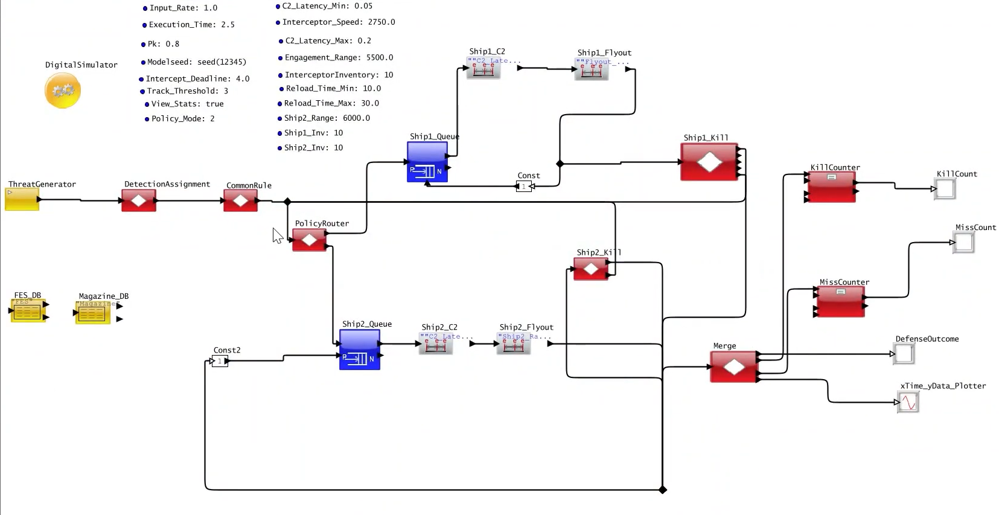
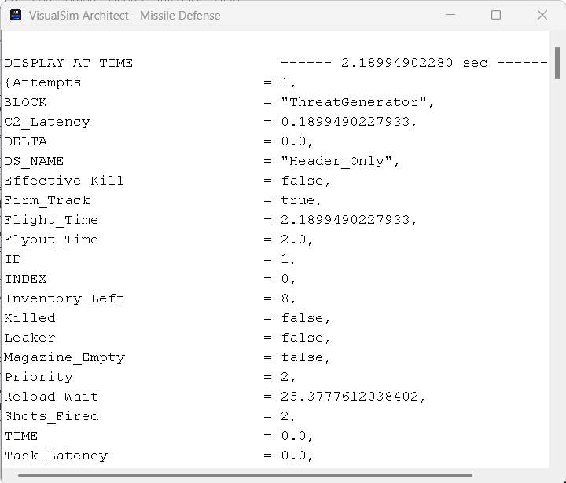
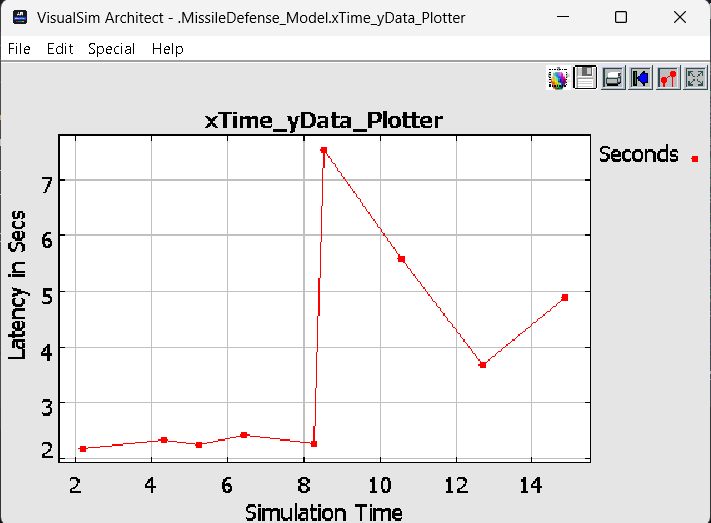
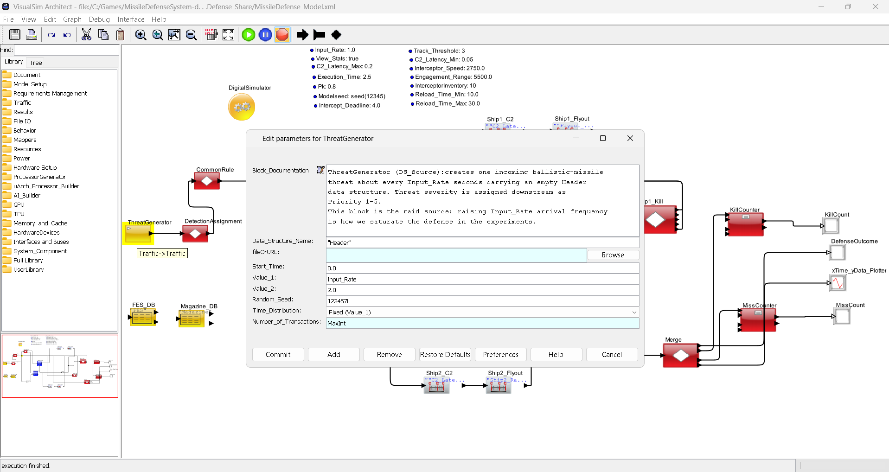

# MissileDefenseSystem

A **VisualSim discrete-event missile defense simulation** (DED-lite) with batch-run scripts, a portable Python experiment runner, and result summarizers. The model simulates threat generation, tracking, command-and-control (C2) latency, interceptor assignment across two ships, engagement outcomes, and magazine/inventory effects.

This repository is the standalone project — all source files sit at the root for easy access and distribution.

---

## Screenshots

| Screenshot | Description |
|---|---|
| [`screenshots/model-architecture.png`](screenshots/model-architecture.png) | Full VisualSim block diagram of the two-ship missile defense pipeline |
| [`screenshots/defense-outcome-display.png`](screenshots/defense-outcome-display.png) | Per-threat outcome record shown in the VisualSim Architect console |
| [`screenshots/kill-miss-counters.png`](screenshots/kill-miss-counters.png) | Cumulative kill and miss count displays from the simulation |
| [`screenshots/latency-plotter.png`](screenshots/latency-plotter.png) | Real-time C2 latency plot over simulation time |
| [`screenshots/threat-timeline.png`](screenshots/threat-timeline.png) | Threat arrival/engagement timeline visualization |

---

## Quick Start

```bash
# 1) Verify your environment (no VisualSim required)
python run_full_policy_experiment.py --dry-run

# 2) Run full sweep (90 runs: 3 policies × 3 Pk values × 10 seeds)
python run_full_policy_experiment.py --vs-ar /path/to/VS_AR --java /path/to/java

# 3) Summarize results
python summarize_full_policy_experiment.py
```

Or use the Windows batch scripts (`*.bat`) — edit the hardcoded paths first.

---

## Contents

| File | Purpose |
|---|---|
| `MissileDefense_Model.xml` | VisualSim/MoML model (Digital/DE simulator). Top-level parameters include `Input_Rate`, `Execution_Time`, `Pk`, `Intercept_Deadline`, `Track_Threshold`, `C2_Latency_Min/Max`, `Policy_Mode`, ship inventories/ranges, etc. |
| `missile_defense_parameters.csv` | Parameter table (value/range, units, source, confidence/assumption) for threat, radar, C2, interceptor, inventory, and sweep settings. |
| `fes_table.csv` | Fire/engagement support table used by the model (e.g. `Priority,shipHint`). |
| `magazine.csv` | Magazine/inventory state table used by the model (e.g. `Ship,Remaining,ReloadUntil`). |
| `run_full_policy_experiment.py` | Portable, terminal-first experiment runner for Policy × Pk × seed sweeps (default 90 runs: policies 0/1/2 × Pk 0.5/0.8/0.95 × seeds 2001–2010). Resolves VisualSim/JDK paths, runs batch simulations, parses outcomes, and prints per-run + aggregate summaries. |
| `MissileDefense_Model_Sweep.bat` | Windows batch example: 3 runs varying `Pk` and seed, writing `MissileDefense_Outcome_run*.txt`. |
| `MissileDefense_Policy_Pk_Sweep.bat` | Windows batch example: 9 runs over `Policy_Mode` {0,1,2} × `Pk` {0.5,0.8,0.95}, writing `MissileDefense_Outcome_p{policy}_pk{tag}.txt`. |
| `MissileDefense_Force_Ship2.bat` | Windows batch example forcing engagement to Ship 2 (`Policy_Mode 2`, `Ship1_Inv 0`, `Ship2_Inv 10`). |
| `summarize_missile_outcome.py` | Summarizes `MissileDefense_Outcome_run*.txt` (threats, raw/effective kills/leakers, firm tracks, Pk). |
| `summarize_missile_policy_pk.py` | Summarizes `MissileDefense_Outcome_p*_pk*.txt` per policy/Pk tag (includes ship assignment counts). |
| `summarize_full_policy_experiment.py` | Aggregates `MissileDefense_Outcome_*.txt` from full experiments (groups by policy/Pk, dedupes by threat ID using last record, reports re-engagements/shots/ship split, raw vs effective Pk). |
| `MissileDefense_Outcome.txt` | Example outcome log (per-threat `DISPLAY AT TIME` records). |
| `MissileDefense_Kill_Count.txt` | Example kill-count display/log. |
| `MissileDefense_Miss_Count.txt` | Example miss/leaker-count display/log. |

---

## Model Architecture & Pipeline

The VisualSim block diagram models a two-ship distributed missile defense system. Threats are generated, detected, prioritized, routed to one of two ship engagement lines, and evaluated for kill effectiveness.


*Figure 1: Full VisualSim block diagram of the missile defense simulation.*

### Data Flow Pipeline

```
[ThreatGenerator] ➔ [DetectionAssignment] ➔ [CommonRule] ➔ [PolicyRouter]
                                                                        ├──➔ [Ship1_Queue] ➔ [Ship1_C2] ➔ [Ship1_Flyout] ➔ [Ship1_Kill] ──┐
                                                                        └──➔ [Ship2_Queue] ➔ [Ship2_C2] ➔ [Ship2_Flyout] ➔ [Ship2_Kill] ──┴──➔ [Merge] ➔ [KillCounter] ➔ [KillCount]
                                                                                                                                                         ├──➔ [MissCounter] ➔ [MissCount]
                                                                                                                                                         ├──➔ [DefenseOutcome]
                                                                                                                                                         └──➔ [xTime_yData_Plotter]
[FES_DB]   [Magazine_DB]
```

### Block Responsibilities

| Block | Role |
|---|---|
| **`ThreatGenerator`** | Generates incoming threat missiles according to `Input_Rate` (seconds between arrivals) and random seed (`Modelseed`). |
| **`DetectionAssignment`** | Simulates radar detection. A threat must accumulate `Track_Threshold` consecutive hits to be considered "firmly tracked" (`Firm_Track = true`). |
| **`CommonRule`** | Applies default prioritization rules using the `FES_DB` lookup table. |
| **`PolicyRouter`** | Routes each threat to Ship 1 or Ship 2 based on `Policy_Mode`: |
| &nbsp; | &bull; **Mode 0** — Sectored: ships defend fixed geographic zones |
| &nbsp; | &bull; **Mode 1** — First-launch: nearest available ship fires first |
| &nbsp; | &bull; **Mode 2** — Bidded-lite: ships "bid" based on inventory and range |
| **`ShipN_Queue`** | FIFO buffer for pending engagements on each ship. |
| **`ShipN_C2`** | Simulates Command & Control processing delay uniformly sampled between `C2_Latency_Min` and `C2_Latency_Max`. |
| **`ShipN_Flyout`** | Computes interceptor transit time from launch point to intercept location using `Interceptor_Speed` and engagement ranges (`Engagement_Range` for Ship 1, `Ship2_Range` for Ship 2). |
| **`ShipN_Kill`** | Determines engagement success: stochastic check against single-shot probability `Pk`; also enforces `Intercept_Deadline` (threat must be killed within this window to be an *effective* kill). Handles magazine depletion and reload delays. |
| **`Merge`** | Merges sorted completion events from both ships into a single stream. |
| **`KillCounter`** | Increments cumulative intercept count → written to `KillCount` display. |
| **`MissCounter`** | Increments cumulative leaker count → written to `MissCount` display. |
| **`DefenseOutcome`** | Prints full structured record for every completed engagement (see Outcome Log Format below). |
| **`xTime_yData_Plotter`** | Plots real-time metric series (e.g., C2 latency, queue depth) against simulation clock. |

#### Outcome Displays During Simulation


*Figure 2: Example `DefenseOutcome` text window showing a completed engagement record with all tracked fields.*


*Figure 3: Cumulative kill count and miss (leaker) count displays updated as engagements complete.*


*Figure 4: `xTime_yData_Plotter` showing C2 latency spikes as queue congestion increases under high threat rates.*

---

## Detailed Field Definitions in Outcome Logs

Each engagement completion emits a structured record to the `DefenseOutcome` display and to the `.txt` output file:

```
DISPLAY AT TIME     ------ 2.1899 sec ------
{
  Attempts                 = 1,
  BLOCK                    = "ThreatGenerator",
  C2_Latency               = 0.1899,
  DELTA                    = 0.0,
  DS_NAME                  = "Header_Only",
  Effective_Kill           = false,       ← within Intercept_Deadline?
  Firm_Track               = true,        ← Track_Hits >= Track_Threshold?
  Flight_Time              = 2.1899,      ← total elapsed (C2 + Flyout)
  Flyout_Time              = 2.0,         ← interceptor transit only
  ID                       = 1,           ← unique threat identifier
  INDEX                    = 0,
  Inventory_Left           = 8,           ← remaining rounds on firing ship
  Killed                   = false,       ← raw stochastic Pk check failed
  Leaker                   = false,
  Magazine_Empty           = false,
  Priority                 = 2,           ← from fes_table.csv lookup
  Reload_Wait              = 25.38,       ← seconds until launcher reloads
  Shots_Fired              = 2,
  TIME                     = 0.0,
  Task_Latency             = 0.0,
  Time_Array               = {0.0, 0.0},
  Trace_Array              = {"Queue_in", "Queue_out"},
  Track_Hits               = 3,
  hasInv1                  = true,
  hasInv2                  = true,
  preferredShip            = 1,
  sectoredShip             = 1,
  ship                     = 1,           ← actual firing ship
  shipHint                 = 1            ← from fes_table.csv
}
```

| Field | Meaning |
|---|---|
| `ID` | Unique numeric identifier for the threat missile. |
| `BLOCK` | Source block emitting the record (`ThreatGenerator`). |
| `Priority` | Threat priority level looked up from `fes_table.csv` row `ID`. |
| `Firm_Track` | `true` if radar detection hits reach `Track_Threshold` (default: 3). |
| `C2_Latency` | Random C2 processing delay (seconds), drawn uniformly from `[C2_Latency_Min, C2_Latency_Max]`. |
| `Flyout_Time` | Interceptor flight time from launch point to predicted intercept location (sec). |
| `Flight_Time` | Total wall-clock time from threat creation to intercept event (`C2_Latency + Flyout_Time`). |
| `Attempts` / `Shots_Fired` | Number of individual interceptor shots launched at this threat. |
| `Killed` | Raw binary kill result from stochastic `Pk` roll (always computed, regardless of deadline). |
| `Effective_Kill` | `true` only if `Killed=true` AND interception occurred before `Intercept_Deadline`. |
| `Leaker` | `true` if the threat survived past the intercept deadline or magazines were empty. |
| `Inventory_Left` | Remaining interceptor count on the firing ship after this engagement. |
| `Magazine_Empty` | `true` when the firing ship's magazine reaches zero and no reload is imminent. |
| `Reload_Wait` | Seconds until the next interceptor can be loaded (based on `Reload_Time_Min/Max`). |
| `TIME` / `Task_Latency` | Scenario start time and any queuing delay experienced before engagement started. |
| `ship` / `preferredShip` / `sectoredShip` | Which ship fired (`ship`), which was preferred by policy (`preferredShip`), and which zone owns the threat (`sectoredShip`). |

---

## Model overview

- **Simulator:** VisualSim Digital/DE (`VisualSim.simulators.de.kernel.DEDirector`, `digitalDomainOnly=true`), model `MissileDefense_Model` (MoML/XML).
- **Inputs/parameters (examples):** threat arrival rate, execution/stop time, interceptor probability of kill (`Pk`), intercept deadline, track confirmation threshold, C2 latency bounds, engagement policy mode, per-ship inventory/range settings.
- **Threat processing:** threats are generated and flow through tracking/C2/engagement logic. Each completed engagement is logged as a structured record with fields such as `ID`, `Priority`, `Track_Hits`, `Firm_Track`, `C2_Latency`, `Flyout_Time`/`Flight_Time`, `Shots_Fired`, `Attempts`, `Killed`, `Effective_Kill`, `Leaker`, `Magazine_Empty`, `Inventory_Left`, `ship`/`preferredShip`/`sectoredShip`/`shipHint`, reload/wait info, etc.
- **Two-ship defense:** outcomes include ship assignment (`ship`, `ship1/ship2` counts in summaries) and inventory/magazine effects; policies can influence allocation.
- **Policy modes:** batch/runner use `Policy_Mode` values (e.g. `0,1,2` in sweeps) to compare engagement/allocation policies (see `missile_defense_parameters.csv`: "DED-lite policy mode (sectored/first-launch/bidded-lite)").
- **Metrics:**
  - **Raw kills / raw Pk:** `Killed` outcomes.
  - **Effective kills / effective Pk:** `Effective_Kill` (accounts for timeliness/leaker criteria as modeled).
  - **Leakers:** threats not effectively killed (e.g. `Leaker=true` / `threats - effective`).
  - **Other:** firm tracks, shots fired, re-engagements (same ID seen multiple times), per-ship load.

---

## Requirements

### To run simulations (VisualSim batch mode)
- **VisualSim** installation (`VS_AR`) with `VisualSim.actor.gui.VisualSimBatchModeSimulator` and required jars (e.g. `com/amity/flexlm/*`) and `bin/policyAll`.
- **Java JDK** (examples use JDK 17). Batch mode is invoked as:
  `java -Dvs.lic=default -Djava.security.policy=<VS_AR>\bin\policyAll -Djava.security.manager=allow --add-opens java.desktop/sun.font=ALL-UNNAMED -classpath <VS_AR;...jars...> VisualSim.actor.gui.VisualSimBatchModeSimulator ... <model.xml>`
- A valid **VisualSim license** for batch execution.
- Model/table files (`MissileDefense_Model.xml`, `fes_table.csv`, `magazine.csv`) available to the run (typically in the working/script directory).

### To run summarizers / portable experiment driver
- **Python 3.x** (standard library only; no third-party packages required).

---

## Running experiments

### 1) Portable Python runner (recommended)

`run_full_policy_experiment.py` is terminal-first and resolves paths portably:

- **VisualSim path:** `--vs-ar PATH` > `VS_AR` env var > `<script-dir>/VS_AR`
- **Java:** `--java PATH` > `JAVA_HOME/bin/java(.exe)`
- **Output dir:** `--outdir DIR` (default: script folder). Outcome `.txt` logs are written there; per-run results and a final aggregate are printed to the terminal.

Examples:
```bash
# Show plan/paths without running (no VisualSim/license needed)
python run_full_policy_experiment.py --dry-run

# Full default sweep: policies 0,1,2 × Pk 0.5,0.8,0.95 × seeds 2001-2010 (90 runs)
python run_full_policy_experiment.py --vs-ar /path/to/VS_AR --java /path/to/java

# Custom subset
python run_full_policy_experiment.py --policies 0,2 --pks 0.8 --seeds 2001,2002 --outdir ./results
```

Outputs per run: `MissileDefense_Outcome_p{mode}_pk{pk-tag}_s{seed}.txt` with a parsed terminal line like:
`policy=... pk=... seed=...: threats=... raw=... effective=... leakers=... raw_Pk=... effective_Pk=... ship1=... ship2=... shots=... reengaged=...`

### 2) Windows batch scripts

The `.bat` files are example batch invocations (they contain **hardcoded local paths** for `JAVA_HOME` and `INSTALL_PATH`/`VS_AR` on the original machine). Edit those variables to match your environment before use:

| Script | Runs | Output pattern |
|---|---|---|
| `MissileDefense_Model_Sweep.bat` | 3 (Pk 0.5/0.8/0.95 × seeds) | `MissileDefense_Outcome_run*.txt` |
| `MissileDefense_Policy_Pk_Sweep.bat` | 9 (Policy × Pk grid) | `MissileDefense_Outcome_p*_pk*.txt` |
| `MissileDefense_Force_Ship2.bat` | 1 (all-to-Ship-2 scenario) | `MissileDefense_Outcome_force_ship2.txt` |

---

## Summarizing results

Run from the directory containing the outcome `.txt` files:

```bash
# Summarize run1/run2/run3-style outputs
python summarize_missile_outcome.py

# Summarize policy×Pk outputs (p*_pk*.txt)
python summarize_missile_policy_pk.py

# Aggregate a full experiment (all MissileDefense_Outcome_*.txt except base Outcome.txt)
python summarize_full_policy_experiment.py
```

Notes:
- `summarize_full_policy_experiment.py` dedupes by threat `ID` (last record wins, matching the runner) and reports `reengaged` (IDs seen more than once) and total `shots`.
- `summarize_missile_outcome.py` / `summarize_missile_policy_pk.py` aggregate records as present in each file (useful for single-run/quick comparisons).

---

## Outcome log format

Each engagement completion is emitted as a block similar to:
```
DISPLAY AT TIME     ------ <t> sec ------
{ID = ..., Priority = ..., Firm_Track = true/false, Killed = true/false,
 Effective_Kill = true/false, Leaker = true/false, ship = 1\|2,
 Shots_Fired = ..., Inventory_Left = ..., C2_Latency = ..., ...}
```
`MissileDefense_Kill_Count.txt` / `MissileDefense_Miss_Count.txt` capture count events over time in the same display-log style.

---

## Example artifacts included

- `MissileDefense_Outcome.txt` — sample outcome log (illustrative of format and metrics such as effective kills, leakers, ship assignment, and inventory depletion).
- `MissileDefense_Kill_Count.txt` — kill counter events from a run.
- `MissileDefense_Miss_Count.txt` — miss/leaker counter events from a run.

---

## Parameters (reference)

See `missile_defense_parameters.csv` for the working parameter set (values/ranges, units, sources, confidence). Key modeled knobs include `Input_Rate`, `Execution_Time`, `Pk`, `Intercept_Deadline`, `Track_Threshold`, `C2_Latency_Min/Max`, `Policy_Mode`, `Ship*_Inv`/`Ship2_Range`, reload timings, and inventory. `fes_table.csv` and `magazine.csv` provide tabular inputs consumed by the model.

---

## Notes

- Batch `.bat` scripts assume a Windows environment and local VisualSim/JDK installs; prefer `run_full_policy_experiment.py` for portable, path-configurable runs and terminal-readable results.
- Actual simulation requires a licensed VisualSim installation; Python scripts can parse/summarize existing outcome logs without VisualSim.
